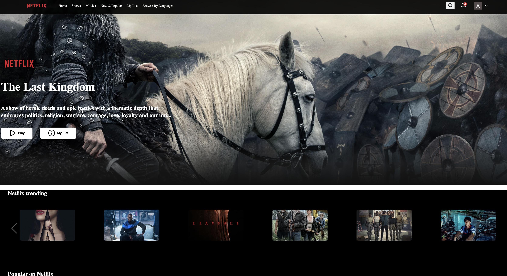

# 🚀 Project done by 

## Kaleb ~  Habiba ~  Berhanu  ~ Erku ~ Yohannes ~ Nigusu ~ Birhan

```diff
+ > This project is netflix.com website cloning by Evangadi May 2026 students

```

---
# Netflix Clone — React Web Application

A responsive Netflix-inspired movie and TV discovery interface built with **React 19** and **Vite**. The application recreates key parts of the Netflix browsing experience, including a navigation header, featured title banner, horizontally scrollable movie collections, interactive movie cards, and a multi-column footer.

Movie and TV metadata is retrieved from **The Movie Database (TMDB) API**. The project also includes a small collection of locally stored poster and promotional images.

> **Disclaimer:** This is an educational, portfolio, and demonstration project. It is not affiliated with, endorsed by, or sponsored by Netflix. Netflix names, logos, and related marks belong to their respective owners. Movie metadata and images are provided by TMDB.

---

## Table of Contents

- [Preview](#preview)
- [Features](#features)
- [Technology Stack](#technology-stack)
- [Project Structure](#project-structure)
- [Getting Started](#getting-started)
- [Environment Variables](#environment-variables)
- [Available Scripts](#available-scripts)
- [How the Application Works](#how-the-application-works)
- [API Reference](#api-reference)
- [Customization](#customization)
- [Troubleshooting](#troubleshooting)
- [Contributing](#contributing)
- [Team](#team)
- [Acknowledgments](#acknowledgments)
- [License](#license)

---

## Preview




---

## Features

### User Interface

- Netflix-inspired dark interface and responsive page layout.
- Header with brand logo, navigation links, search control, notification icon, and profile menu.
- Featured banner populated with a randomly selected Netflix original title from TMDB.
- Featured title name, backdrop image, and shortened overview.
- Movie cards with poster artwork and hover details.
- Horizontal, swipeable movie collections powered by Swiper.
- Multiple movie and TV categories displayed in separate rows.
- Footer with grouped navigation links and social media icons.
- Component-level styling with CSS Modules.

### Movie and TV Collections

The application requests the following collections from TMDB:

- Trending titles
- Netflix originals
- Top-rated movies
- Action
- Comedy
- Horror
- Romance
- Documentaries

### Local Assets

The project also contains locally stored image assets used by the interface and sample movie data.

---

## Technology Stack

| Area | Technology |
|---|---|
| UI library | React 19 |
| Build tool and development server | Vite 8 |
| Language | JavaScript (ES modules / JSX) |
| Styling | CSS and CSS Modules |
| API requests | Axios |
| Movie data | The Movie Database (TMDB) API |
| Carousels / sliders | Swiper |
| Icons | Lucide React and React Icons |
| Routing setup | React Router |
| Code quality | ESLint |

**Note:** The current repository is a frontend application. It does not include a Node.js/Express backend or a database.

---

## Project Structure

```text
netflixClone-main/
├── public/
│   ├── favicon.svg
│   └── icons.svg
├── src/
│   ├── assets/
│   │   └── image/                  # Logos, posters, banners, and local artwork
│   ├── Components/
│   │   ├── Banner/
│   │   │   ├── Banner.jsx
│   │   │   └── Banner.module.css
│   │   ├── DisplayRow/
│   │   │   ├── DisplayRow.jsx
│   │   │   └── DisplayRow.module.css
│   │   ├── Footer/
│   │   │   ├── Footer.jsx
│   │   │   └── Footer.module.css
│   │   ├── Header/
│   │   │   ├── Header.jsx
│   │   │   └── Header.module.css
│   │   ├── MovieCard/
│   │   │   ├── MovieCard.jsx
│   │   │   └── MovieCard.module.css
│   │   └── SlideShow/
│   │       ├── SlideShow.jsx
│   │       └── SlideShow.module.css
│   ├── Data/
│   │   └── Data.js                  # Local sample movie data
│   ├── Utility/
│   │   ├── MovieInstance.js         # Shared Axios TMDB client
│   │   └── requestUrls.js           # TMDB endpoint definitions
│   ├── App.css
│   ├── App.jsx                      # Main application layout
│   ├── index.css
│   └── main.jsx                     # React application entry point
├── .env.example                     # Create this file locally (see below)
├── .gitignore
├── eslint.config.js
├── index.html
├── package.json
├── package-lock.json
├── vite.config.js
└── README.md
```

---

## Getting Started

Follow these instructions to run the project on your local machine.

### Prerequisites

Install the following before starting:

- [Node.js](https://nodejs.org/) — use a current supported LTS release.
- npm — included with Node.js.
- Git (optional, for cloning the repository).
- A TMDB API key — required to load live movie and TV data.

Check your installations:

```bash
node --version
npm --version
```

### 1. Clone the Repository

```bash
git clone <YOUR_REPOSITORY_URL>
cd netflixClone-main
```

If you already downloaded the project ZIP, extract it and open the project directory in your terminal or code editor.

### 2. Install Dependencies

```bash
npm install
```

### 3. Configure the TMDB API Key

The application reads the API key from the Vite environment variable `VITE_DB_API_KEY`.

Create a file named `.env` in the project root:

```env
VITE_DB_API_KEY=your_tmdb_api_key_here
```

Replace the example value with your own TMDB API key. See [Environment Variables](#environment-variables) for more information.

### 4. Start the Development Server

```bash
npm run dev
```

Open the local URL printed in your terminal, usually:

```text
http://localhost:5173
```

### 5. Create a Production Build

```bash
npm run build
```

The optimized production files are generated in the `dist/` directory.

To preview the production build locally:

```bash
npm run preview
```

---

## Environment Variables

The project uses Vite environment variables for API configuration.

| Variable | Required | Description |
|---|---:|---|
| `VITE_DB_API_KEY` | Yes | TMDB API key used by the movie request endpoints. |

Example `.env` file:

```env
VITE_DB_API_KEY=your_tmdb_api_key_here
```

You can optionally create a `.env.example` file and commit that template to the repository:

```env
VITE_DB_API_KEY=replace_with_your_tmdb_api_key
```

**Important security note:** Vite exposes variables prefixed with `VITE_` in the client-side bundle. This means the TMDB key is visible to users of the deployed website. Do not put passwords, private tokens, database credentials, or other sensitive secrets in frontend environment variables. For production applications that require a secret API credential, make requests through a secure backend.

After changing `.env`, restart the Vite development server.

---

## Available Scripts

Run these commands from the project root:

| Command | Description |
|---|---|
| `npm install` | Installs project dependencies. |
| `npm run dev` | Starts the Vite development server. |
| `npm run build` | Builds the application for production. |
| `npm run preview` | Serves the production build locally for preview. |
| `npm run lint` | Runs ESLint to check the project files. |

---

## How the Application Works

### 1. Application Entry Point

`src/main.jsx` mounts the React application and renders the main `App` component inside `StrictMode` and `BrowserRouter`.

### 2. Main Layout

`src/App.jsx` combines the primary page sections:

- `Header`
- `Banner`
- `DisplayRow`
- `Footer`

### 3. TMDB API Client

`src/Utility/MovieInstance.js` creates a reusable Axios instance with the TMDB API base URL:

```text
https://api.themoviedb.org/3
```

### 4. API Endpoints

`src/Utility/requestUrls.js` defines the API paths for trending titles, Netflix originals, top-rated movies, and genre-based collections. The API key is read from `import.meta.env.VITE_DB_API_KEY`.

### 5. Movie Collections

`src/Components/DisplayRow/DisplayRow.jsx` requests the eight movie collections with `Promise.all()` and passes the returned results to individual `SlideShow` components.

### 6. Sliders and Movie Cards

`src/Components/SlideShow/SlideShow.jsx` uses Swiper to display movie cards in horizontal carousels. Each slide renders a `MovieCard` component.

### 7. Component Styling

Each major component has its own CSS Module file. This keeps most component styles scoped and makes the project easier to maintain.

---

## API Reference

This project uses [The Movie Database (TMDB) API](https://developer.themoviedb.org/docs).

The configured endpoints include:

| Collection | TMDB endpoint |
|---|---|
| Trending | `/trending/all/week` |
| Netflix Originals | `/discover/tv?with_networks=213` |
| Top Rated | `/movie/top_rated` |
| Action | `/discover/movie?with_genres=28` |
| Comedy | `/discover/movie?with_genres=35` |
| Horror | `/discover/movie?with_genres=27` |
| Romance | `/discover/movie?with_genres=10749` |
| Documentaries | `/discover/movie?with_genres=99` |

TMDB image assets are loaded using the image base URLs in the banner and movie card components.

---

## Customization

### Add or Update Local Movie Data

Edit `src/Data/Data.js` to add or update locally imported movie artwork and metadata.

### Add a Movie Category

1. Add the appropriate TMDB endpoint to `src/Utility/requestUrls.js`.
2. Add a state property for the new collection in `DisplayRow.jsx`.
3. Request the endpoint in the `Promise.all()` call.
4. Save the response results in state.
5. Render another `SlideShow` with a descriptive title and the new collection.

### Update Component Styles

Edit the relevant `.module.css` file inside `src/Components/`. Global styles can be updated in `src/index.css` and `src/App.css`.

---

## Troubleshooting

| Problem | Suggested solution |
|---|---|
| Movie rows are empty | Confirm that `.env` exists in the project root and contains a valid `VITE_DB_API_KEY`. Restart the Vite server after changing it. |
| TMDB returns an unauthorized response | Check that your API key is valid and enabled for the selected TMDB API authentication method. |
| Posters or banner images do not load | Check your internet connection and inspect the browser console for failed TMDB requests or missing image paths. |
| Dependencies are missing | Run `npm install` from the project root. |
| Port 5173 is already in use | Use the alternative local URL provided by Vite, or stop the process using that port. |
| Production build fails | Run `npm run lint` and review the terminal output from `npm run build` for errors. |

---

## Contributing

Contributions and improvements are welcome.

1. Fork the repository.
2. Create a feature branch:
   ```bash
   git checkout -b feature/your-feature-name
   ```
3. Make your changes and test them locally.
4. Run the project checks:
   ```bash
   npm run lint
   npm run build
   ```
5. Commit your changes:
   ```bash
   git add .
   git commit -m "Add: describe your change"
   ```
6. Push your branch and open a pull request.

Please keep components reusable, follow the existing folder structure, and use CSS Modules for component-specific styling.

---

## Team

**Evangadi — Group 3**

Project contributors listed in the original project documentation:

- Kaleb
- Habiba
- Berhanu
- Erku
- Yohannes
- Nigusu
- Birhan

---

## Acknowledgments

- [Netflix](https://www.netflix.com/) for the interface inspiration.
- [The Movie Database (TMDB)](https://www.themoviedb.org/) for movie and TV metadata and artwork.
- [Evangadi Networks](https://www.evangadi.com/) and the project contributors for the learning and collaboration experience.
- The open-source maintainers of React, Vite, Axios, Swiper, Lucide React, and React Icons.

---

## License

No formal open-source license file was included in the supplied project archive. If you intend to publish or distribute this project, add a `LICENSE` file specifying the terms under which others may use, modify, and distribute your code.

---

<p align="center">
  Built with React, Vite, and a love of learning.
</p>

---

## 📮 Contact

- **KALEB** - kaleb.z.gabriel@gmail.com
- **HABIBA** - habibaalihabibaali6@gmail.com
- **NIGUSU** - nigusu929@gmail.com
- **YOHANNES** - yohannesmengistu04@gmail.com
- **BIRHAN** - birhandove@gmail.com
- **ERKU** - kifleerku@gmail.com
- **BERHANU** - berhanuster@gmail.com

  
- **Project Link:** [Group-3-of-Group-3](https://github.com/habibaali5/appleClone.git)


